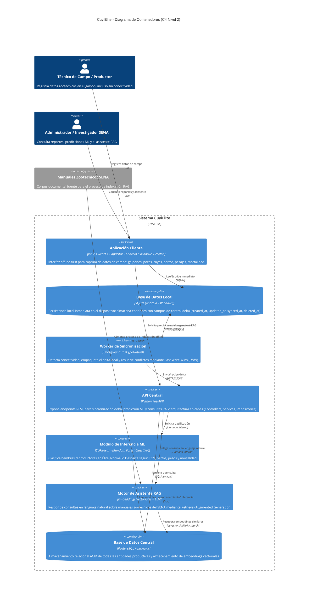
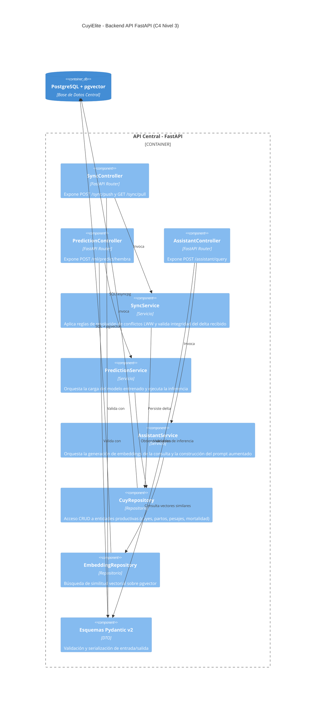
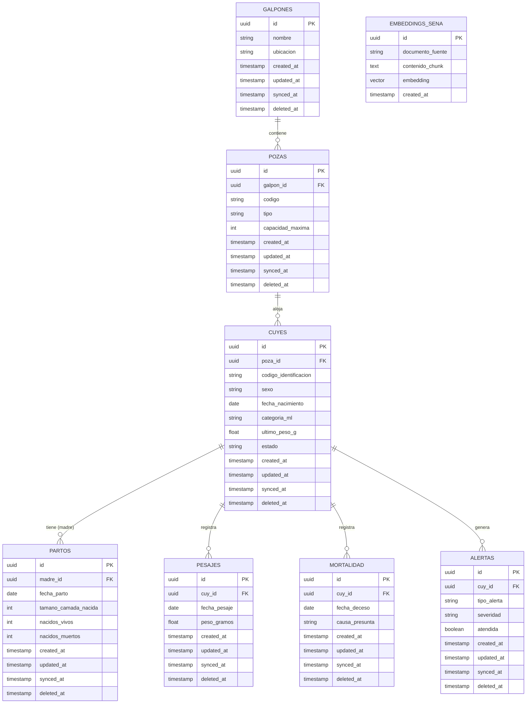
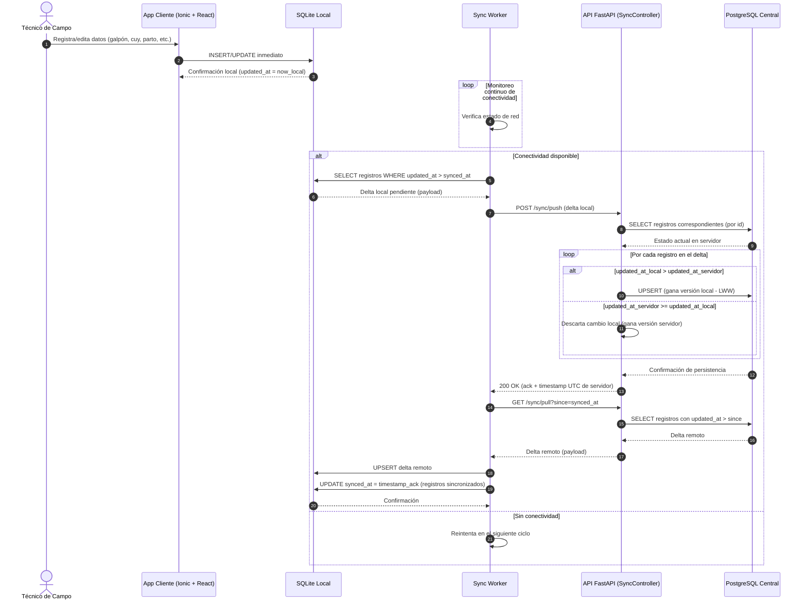
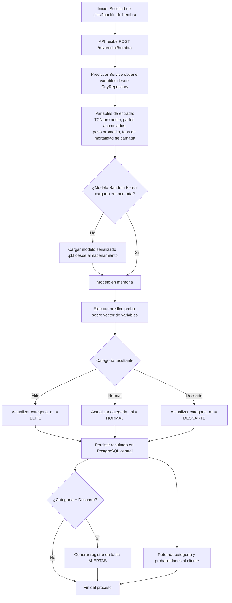
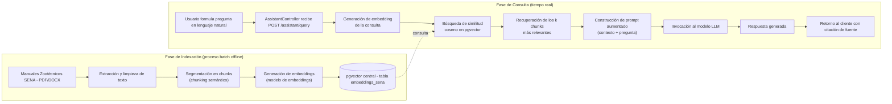

# CuyiElite — Especificación de Arquitectura Técnica

**Sistema Tecnológico de Apoyo a la Toma de Decisiones para Optimizar Procesos y Reducir la Mortalidad en la Producción de Cuyes**

Universidad Cooperativa de Colombia (UCC) — Facultad de Ingeniería — Programa de Ingeniería de Software
Autores: Oskar Julián Ortiz Ortiz, Diery Alejandro Valencia Itacual
Asesores: Ing. Cristian Camilo Ordoñez Quintero, Mangin Luis Montenegro
Campo de validación: Centro Agropecuario Lope del SENA (Pasto, Nariño)
Metodología: Extreme Programming (XP)

> **Nota de actualización técnica (ADR 0002):** el stack original definía React Native + Expo con persistencia local en WatermelonDB/SQLite. Por recomendación del asesor, el cliente migra a **Ionic + React** (empaquetado mediante Capacitor). Para la persistencia local se evaluó PostgreSQL y, tras la validación con el asesor, quedó definida **SQLite en Android y Windows**, manteniendo **PostgreSQL + pgvector** como base central. La ADR 0002 (`docs/decisiones/0002-persistencia-local-sqlite.md`) formaliza esa decisión y sustituye solo la elección de base local de la ADR 0001. Los diagramas y el DDL central de este documento reflejan el estado vigente; el numeral 0 conserva el historial de la recomendación inicial de PostgreSQL local, ya sustituida.

---

## 0. Historial de Actualizaciones del Stack Tecnológico — Cliente y Persistencia Local

> **Sección histórica.** Registra las recomendaciones sucesivas sobre el cliente y la
> persistencia local, con su resultado final. El estado vigente es: **SQLite** como base
> local en **Android y Windows** y **PostgreSQL + pgvector** como base central, conforme a
> la ADR 0002. Todo lo que indica PostgreSQL como base local se conserva como antecedente
> y **no es la configuración actual**.

### Cambio 1: Framework de cliente — de React Native/Expo a Ionic

Por recomendación del asesor, el cliente multiplataforma migra a **Ionic + React**, empaquetado mediante **Capacitor** para su distribución nativa en Android y Windows Desktop. Esta es la variante confirmada por el equipo, por ser la ruta oficialmente soportada por Ionic:

- **Ionic + React (con Capacitor) — decisión confirmada:** el cliente se construye con componentes web de Ionic (`@ionic/react`) y se empaqueta como app nativa (Android/Windows) mediante Capacitor. Es la combinación estándar y con mejor soporte oficial de Ionic.
- *(Alternativa descartada) Ionic + React Native:* se evaluó integrar componentes visuales de Ionic sobre una base de React Native, pero se descartó por ser una combinación menos convencional (Ionic está pensado principalmente para Capacitor/Cordova, no para el runtime de React Native), lo cual habría exigido un spike técnico adicional para validar compatibilidad de librerías antes de comprometer el desarrollo de los módulos de campo.

**Justificación de la decisión:** Ionic + React con Capacitor es la ruta de menor riesgo técnico para el equipo, al ser el camino oficialmente soportado por Ionic tanto para Android como para Windows Desktop, evitando la incertidumbre de compatibilidad que implicaría combinarlo con React Native.

### Cambio 2 (histórico, sustituido): Persistencia local — de SQLite/WatermelonDB a PostgreSQL local

**Resultado de la validación (ADR 0002, 2026-11-02):** la base local no se mantiene en PostgreSQL; pasa a **SQLite** en Android y Windows. El texto siguiente se conserva como registro de la recomendación inicial y de la duda técnica que motivó su revisión.

Por recomendación del asesor, la base de datos local deja de ser SQLite/WatermelonDB y pasa a ser **una instancia de PostgreSQL** administrada mediante **DBeaver** (cliente de administración de bases de datos, no un motor de base de datos en sí mismo — DBeaver se usa para inspeccionar y administrar la instancia local de PostgreSQL, de forma análoga a como podría usarse para la instancia central).

**Consideración técnica que el equipo debía validar con el asesor (histórico):** WatermelonDB/SQLite se eligió originalmente porque son motores embebidos, livianos y diseñados para ejecutarse dentro de una aplicación móvil sin un proceso de servidor independiente — una condición importante para el escenario offline-first en campo, donde el dispositivo (celular Android del técnico) no siempre tiene capacidad ni corresponde ejecutar un servidor de base de datos completo. PostgreSQL, en cambio, es un motor cliente-servidor que requiere un proceso `postgres` corriendo (ya sea nativo o en contenedor). Esta arquitectura es viable sin inconvenientes en el **cliente de Windows Desktop**, donde sí es razonable instalar una instancia local de PostgreSQL. Para el **cliente móvil Android**, se recomendaba validar con el asesor una de estas dos rutas antes de avanzar:

1. Ejecutar PostgreSQL empaquetado para Android (existen distribuciones experimentales, pero con soporte y estabilidad limitados en producción), o
2. Mantener PostgreSQL como base de datos local únicamente en el cliente de escritorio, y definir junto con el asesor qué motor usará específicamente el cliente móvil de campo.

Este documento asumió, mientras la validación estuvo pendiente, que la base de datos local (en cualquiera de los clientes) era PostgreSQL. Esa suposición quedó sustituida por la ADR 0002: la base local vigente es SQLite en Android y Windows. Ver Cambio 3.

### Cambio 3: Persistencia local vigente — SQLite en Android y Windows

La validación con el asesor se comunicó y Oskar la confirmó: la base local no se mantiene en PostgreSQL y pasa a **SQLite**, en **Android y Windows**. La base **central** sigue siendo **PostgreSQL + pgvector**, sin cambios. El registro formal está en la ADR 0002 (`docs/decisiones/0002-persistencia-local-sqlite.md`), que sustituye únicamente la elección de base local de la ADR 0001; Ionic + React y FastAPI mantienen su alcance.

Pendiente de diseño con Diery (no decidido en esta actualización):

- Esquema/DDL de SQLite y su mapeo con el esquema central: no se traducen automáticamente UUID, TIMESTAMPTZ, triggers ni el dialecto de PostgreSQL.
- Conector o plugin de SQLite y su empaquetado en Windows.
- Cifrado, migraciones y política de backups locales.

Las reglas de sincronización (Last Write Wins, asignación de `updated_at` y contratos `/sync`) no cambian con este cambio de motor.

---

---

## 1. Metodología de Desarrollo de Software (Extreme Programming — XP)

### 1.1 Selección y Justificación de la Metodología

Para el desarrollo del sistema CuyiElite se adoptó la metodología ágil **Extreme Programming (XP)**, propuesta por Kent Beck, en razón de las siguientes características particulares del proyecto:

- **Equipo de desarrollo reducido** (dos ingenieros de software: Oskar Julián Ortiz Ortiz y Diery Alejandro Valencia Itacual), condición para la cual XP fue originalmente concebida, a diferencia de metodologías orientadas a equipos numerosos como SAFe o LeSS.
- **Requisitos susceptibles de evolución constante**, dado que el sistema se valida directamente en campo (Centro Agropecuario Lope del SENA) y los criterios zootécnicos —como las variables de entrada del modelo de Machine Learning— pueden ajustarse conforme el asesor técnico y los productores retroalimenten el prototipo. La propia actualización de stack documentada en el numeral 0 de este documento (migración a Ionic + React y definición de SQLite como base local) es evidencia directa de este principio de adaptación continua.
- **Necesidad de entregas funcionales tempranas y frecuentes**, permitiendo validar con los asesores (Ing. Cristian Camilo Ordoñez Quintero y Mangin Luis Montenegro) el avance real del sistema en cada iteración, en lugar de esperar a un único entregable final.
- **Alto componente técnico e incertidumbre de diseño**, propio de la integración de tres subsistemas complejos —sincronización offline-first, modelo de Machine Learning y motor RAG— donde el diseño simple y el refactoring continuo reducen el riesgo de sobre-ingeniería prematura.

### 1.2 Valores Fundamentales de XP Aplicados al Proyecto

| Valor | Aplicación concreta en CuyiElite |
|---|---|
| **Comunicación** | Reuniones periódicas entre los dos ingenieros de software y los asesores para validar avances de cada módulo (sincronización, ML, RAG) antes de iniciar el siguiente. |
| **Simplicidad** | Se prioriza la solución más simple que funcione en cada iteración (p. ej., iniciar con un modelo Random Forest básico antes de optimizar hiperparámetros). |
| **Retroalimentación (Feedback)** | Validación continua en campo con técnicos del SENA, quienes usan la app y reportan fricciones de uso real en el galpón. |
| **Valentía (Courage)** | Disposición a refactorizar el esquema de sincronización o el modelo de datos si la validación en campo revela inconsistencias, sin apego a decisiones de diseño previas (como ocurrió con el cambio de stack del numeral 0). |
| **Respeto** | Reconocimiento del aporte técnico de ambos ingenieros de software y de la experiencia práctica de los técnicos de campo como fuente legítima de requisitos. |

### 1.3 Roles del Equipo de Desarrollo

| Rol XP (teórico) | Rol profesional adoptado | Responsable |
|---|---|---|
| Customer | Cliente / Usuario Validador | Asesores del proyecto y personal técnico del Centro Agropecuario Lope (SENA) |
| Programmer | **Ingeniero de Software** | Oskar Julián Ortiz Ortiz — Ingeniero de Software, Tech Lead / Arquitecto (diseño de arquitectura, sincronización offline-first, backend FastAPI) |
| Programmer | **Ingeniero de Software** | Diery Alejandro Valencia Itacual — Ingeniero de Software, Especialista en Datos e IA (modelo Random Forest, motor RAG, modelo de datos) |
| Tracker / Coach | Ingeniero de Software — Líder Técnico (rol rotativo) | Compartido por ambos integrantes, con apoyo metodológico de los directores del Trabajo de Grado |

### 1.4 Prácticas de XP Adoptadas

1. **Historias de Usuario (User Stories):** los requisitos se documentan como historias breves desde la perspectiva del técnico de campo o del investigador (p. ej., *"Como técnico de campo, quiero registrar el peso de un cuy sin conexión a internet, para no perder el dato si no hay señal en el galpón"*).
2. **Juego de la Planificación (Planning Game):** al inicio de cada iteración se priorizan las historias de usuario según valor para el proyecto (p. ej., el módulo de sincronización offline se priorizó sobre el motor RAG, al ser prerrequisito funcional del sistema).
3. **Entregas Pequeñas (Small Releases):** el sistema se construye por incrementos funcionales verificables, siguiendo el orden natural de dependencia entre capas: primero el modelo de datos y la persistencia local (SQLite, numeral 0), luego la sincronización, después el módulo de Machine Learning, y finalmente el motor RAG.
4. **Diseño Simple (Simple Design):** se evita construir abstracciones no requeridas por la iteración actual; por ejemplo, el modelo Random Forest se implementó en su forma más simple antes de evaluar ajuste de hiperparámetros o validación cruzada avanzada.
5. **Pruebas (Testing First):** se establecen pruebas unitarias con `pytest` para los `Services` y `Repositories` del backend FastAPI antes o durante la implementación de cada funcionalidad, garantizando cobertura sobre la lógica crítica (especialmente la resolución de conflictos LWW).
6. **Refactorización (Refactoring):** revisión periódica del código para mejorar su estructura sin alterar su comportamiento externo, aplicada especialmente a la capa de `Repositories` conforme crece el número de entidades sincronizables.
7. **Programación en Parejas (Pair Programming):** practicada entre los dos integrantes del equipo en los módulos de mayor riesgo técnico (algoritmo de resolución de conflictos LWW y pipeline de embeddings del motor RAG).
8. **Integración Continua (Continuous Integration):** el código se integra frecuentemente al repositorio compartido, ejecutando pruebas automatizadas en cada integración para detectar tempranamente errores de compatibilidad entre los módulos desarrollados por cada integrante.
9. **Cliente en Sitio (On-site Customer):** el Centro Agropecuario Lope del SENA funge como entorno de validación continua, permitiendo obtener retroalimentación directa del usuario final (técnico de campo) durante el desarrollo, no solo al final del proyecto.
10. **Estándares de Codificación (Coding Standards):** se define una guía de estilo común (PEP 8 para Python/FastAPI, convenciones de ESLint/Prettier para Ionic + React) para mantener consistencia entre el código producido por ambos ingenieros de software.
11. **Propiedad Colectiva del Código (Collective Code Ownership):** cualquiera de los dos ingenieros de software puede modificar cualquier módulo del sistema cuando sea necesario, evitando dependencias críticas de conocimiento en una sola persona.

### 1.5 Ciclo de Vida Iterativo Aplicado a CuyiElite

El desarrollo se organiza en iteraciones cortas (recomendado: 1 a 2 semanas), cada una siguiendo el ciclo: **Planning Game → Diseño Simple → Pair Programming + TDD → Integración Continua → Entrega Pequeña → Retroalimentación en Campo**, retornando nuevamente al Planning Game de la siguiente iteración. Este ciclo se repite de forma continua durante todo el desarrollo del proyecto: cada iteración cierra con retroalimentación real del Centro Agropecuario Lope del SENA, la cual reingresa como insumo para priorizar la siguiente iteración. Para el detalle de cómo estas fases se articulan con el diseño metodológico de la investigación, ver el documento de Metodología y Diseño de la Investigación (numeral 3.3, "Fases de la Investigación Aplicada al Ciclo de Desarrollo XP").

### 1.6 Herramientas de Soporte a la Metodología

| Categoría | Herramienta | Propósito |
|---|---|---|
| Control de versiones | Git + repositorio remoto (GitHub/GitLab) | Integración continua y propiedad colectiva del código |
| Gestión de historias de usuario | Tablero Kanban (Trello, Jira o similar) | Visualización del Planning Game e iteraciones |
| Pruebas automatizadas | `pytest` (backend), Jest/React Testing Library (cliente Ionic + React) | Soporte a la práctica de Testing First |
| Administración de bases de datos | **DBeaver** (base central PostgreSQL) | Inspección y administración de la instancia central durante el desarrollo; la herramienta para el archivo SQLite local queda pendiente de decisión (ADR 0002) |
| Integración continua | GitHub Actions / GitLab CI | Ejecución automática de pruebas en cada integración |
| Documentación técnica y diagramas | Mermaid.js, Miro | Diagramas de arquitectura, DER y flujos, versionables y colaborativos |
| Comunicación con el cliente | Reuniones periódicas presenciales en el SENA + canal de mensajería | Retroalimentación continua tipo "cliente en sitio" |

### 1.7 Justificación Metodológica Frente a Alternativas

Se descartaron explícitamente otras metodologías por las siguientes razones, útiles para sustentar la elección ante el jurado evaluador:

- **Cascada (Waterfall):** inadecuada porque exige especificación completa de requisitos antes de iniciar el desarrollo, lo cual contradice la naturaleza exploratoria de integrar Machine Learning y RAG, donde los requisitos técnicos se refinan con la experimentación.
- **Scrum:** aunque también ágil, está orientada a equipos con roles diferenciados (Scrum Master, Product Owner, equipo de desarrollo) que no se ajustan a la escala de un equipo de dos ingenieros de software de Trabajo de Grado; sus ceremonias formales añaden sobrecarga de proceso desproporcionada para el tamaño del equipo.
- **Kanban puro:** carece de prácticas técnicas explícitas (TDD, refactoring, pair programming) que sí son relevantes para la calidad del código en un proyecto académico evaluado también por criterios de ingeniería de software, no solo de flujo de trabajo.

---

## 2. Diagrama de Arquitectura de Contenedores (C4 — Nivel 2)

El presente diagrama describe, en el segundo nivel del modelo C4, los contenedores que conforman el sistema CuyiElite y sus relaciones de comunicación.



### Explicación de módulos

- **Aplicación Cliente (Ionic + React + Capacitor):** interfaz multiplataforma (Android móvil y Windows Desktop) empleada por el técnico de campo, construida sobre Ionic + React y empaquetada mediante Capacitor. Prioriza la disponibilidad sobre la consistencia inmediata (offline-first), permitiendo el registro ininterrumpido de datos en el Centro Agropecuario Lope, incluso en ausencia de conectividad a internet.
- **Base de Datos Local (SQLite):** capa de persistencia embebida que garantiza lectura y escritura inmediata sin latencia de red ni proceso de servidor en el dispositivo (Android y Windows). Cada entidad incorpora los campos de control delta necesarios para la sincronización posterior. El DDL de SQLite y su mapeo con el esquema central quedan pendientes de diseño con Diery (ADR 0002, numeral 0).
- **Worker de Sincronización:** proceso en segundo plano encargado de monitorear el estado de conectividad del dispositivo, calcular el delta pendiente (registros con `updated_at > synced_at`) y ejecutar el protocolo de sincronización contra la API central.
- **API Central (FastAPI):** puerta de entrada única al ecosistema de datos centralizados, estructurada en capas de Controllers (rutas), Services (lógica de negocio) y Repositories (acceso a datos), lo cual favorece la mantenibilidad y las pruebas unitarias exigidas por la metodología XP.
- **Módulo de Inferencia ML:** componente que ejecuta el modelo Random Forest Classifier previamente entrenado, encargado de categorizar automáticamente a las hembras reproductoras.
- **Motor de Asistente RAG:** componente de recuperación aumentada por generación que combina búsqueda semántica vectorial (pgvector) con un modelo de lenguaje, permitiendo consultas en lenguaje natural sobre los manuales zootécnicos del SENA.
- **Base de Datos Central (PostgreSQL + pgvector):** fuente única de verdad del sistema, con soporte transaccional ACID para las entidades productivas y capacidad nativa de almacenamiento y búsqueda de vectores de embeddings.

---

## 3. Diagrama de Componentes — Backend API (C4 — Nivel 3)

Ampliación del contenedor "API Central" en sus componentes internos, conforme a la arquitectura en capas adoptada.



---

## 4. Diagrama Entidad-Relación (DER)

Modelo relacional lógico compartido por la base central (PostgreSQL + pgvector) y la base local (SQLite en Android y Windows, ADR 0002). Ambas capas comparten entidades y campos de control delta, pero no el mismo motor: la implementación física en SQLite —tipos de datos, generación de UUID, marcas de tiempo, triggers y dialecto— requiere un diseño propio y su mapeo con el esquema central, pendiente de diseño con Diery. Este DER describe el modelo, no un DDL ejecutable en ambos motores.



---

## 5. Scripts DDL — PostgreSQL Central

```sql
-- Extensión requerida para soporte vectorial
CREATE EXTENSION IF NOT EXISTS vector;
CREATE EXTENSION IF NOT EXISTS "uuid-ossp";

CREATE TABLE galpones (
    id UUID PRIMARY KEY DEFAULT uuid_generate_v4(),
    nombre VARCHAR(120) NOT NULL,
    ubicacion VARCHAR(255),
    created_at TIMESTAMPTZ NOT NULL DEFAULT now(),
    updated_at TIMESTAMPTZ NOT NULL DEFAULT now(),
    synced_at TIMESTAMPTZ,
    deleted_at TIMESTAMPTZ
);

CREATE TABLE pozas (
    id UUID PRIMARY KEY DEFAULT uuid_generate_v4(),
    galpon_id UUID NOT NULL REFERENCES galpones(id),
    codigo VARCHAR(50) NOT NULL,
    tipo VARCHAR(50) NOT NULL,
    capacidad_maxima INTEGER NOT NULL DEFAULT 0,
    created_at TIMESTAMPTZ NOT NULL DEFAULT now(),
    updated_at TIMESTAMPTZ NOT NULL DEFAULT now(),
    synced_at TIMESTAMPTZ,
    deleted_at TIMESTAMPTZ
);

CREATE TABLE cuyes (
    id UUID PRIMARY KEY DEFAULT uuid_generate_v4(),
    poza_id UUID NOT NULL REFERENCES pozas(id),
    codigo_identificacion VARCHAR(50) NOT NULL UNIQUE,
    sexo VARCHAR(1) NOT NULL CHECK (sexo IN ('M','H')),
    fecha_nacimiento DATE,
    categoria_ml VARCHAR(20) CHECK (categoria_ml IN ('ELITE','NORMAL','DESCARTE')),
    ultimo_peso_g NUMERIC(8,2),
    estado VARCHAR(20) NOT NULL DEFAULT 'ACTIVO',
    created_at TIMESTAMPTZ NOT NULL DEFAULT now(),
    updated_at TIMESTAMPTZ NOT NULL DEFAULT now(),
    synced_at TIMESTAMPTZ,
    deleted_at TIMESTAMPTZ
);

CREATE TABLE partos (
    id UUID PRIMARY KEY DEFAULT uuid_generate_v4(),
    madre_id UUID NOT NULL REFERENCES cuyes(id),
    fecha_parto DATE NOT NULL,
    tamano_camada_nacida INTEGER NOT NULL,
    nacidos_vivos INTEGER NOT NULL DEFAULT 0,
    nacidos_muertos INTEGER NOT NULL DEFAULT 0,
    created_at TIMESTAMPTZ NOT NULL DEFAULT now(),
    updated_at TIMESTAMPTZ NOT NULL DEFAULT now(),
    synced_at TIMESTAMPTZ,
    deleted_at TIMESTAMPTZ
);

CREATE TABLE pesajes (
    id UUID PRIMARY KEY DEFAULT uuid_generate_v4(),
    cuy_id UUID NOT NULL REFERENCES cuyes(id),
    fecha_pesaje DATE NOT NULL,
    peso_gramos NUMERIC(8,2) NOT NULL,
    created_at TIMESTAMPTZ NOT NULL DEFAULT now(),
    updated_at TIMESTAMPTZ NOT NULL DEFAULT now(),
    synced_at TIMESTAMPTZ,
    deleted_at TIMESTAMPTZ
);

CREATE TABLE mortalidad (
    id UUID PRIMARY KEY DEFAULT uuid_generate_v4(),
    cuy_id UUID NOT NULL REFERENCES cuyes(id),
    fecha_deceso DATE NOT NULL,
    causa_presunta VARCHAR(255),
    created_at TIMESTAMPTZ NOT NULL DEFAULT now(),
    updated_at TIMESTAMPTZ NOT NULL DEFAULT now(),
    synced_at TIMESTAMPTZ,
    deleted_at TIMESTAMPTZ
);

CREATE TABLE alertas (
    id UUID PRIMARY KEY DEFAULT uuid_generate_v4(),
    cuy_id UUID NOT NULL REFERENCES cuyes(id),
    tipo_alerta VARCHAR(50) NOT NULL,
    severidad VARCHAR(20) NOT NULL DEFAULT 'MEDIA',
    atendida BOOLEAN NOT NULL DEFAULT false,
    created_at TIMESTAMPTZ NOT NULL DEFAULT now(),
    updated_at TIMESTAMPTZ NOT NULL DEFAULT now(),
    synced_at TIMESTAMPTZ,
    deleted_at TIMESTAMPTZ
);

-- Tabla de embeddings para el motor RAG (dimensión ejemplo: 1536)
CREATE TABLE embeddings_sena (
    id UUID PRIMARY KEY DEFAULT uuid_generate_v4(),
    documento_fuente VARCHAR(255) NOT NULL,
    contenido_chunk TEXT NOT NULL,
    embedding VECTOR(1536) NOT NULL,
    created_at TIMESTAMPTZ NOT NULL DEFAULT now()
);

-- Índice HNSW para búsqueda de similitud vectorial eficiente
CREATE INDEX idx_embeddings_sena_hnsw
    ON embeddings_sena USING hnsw (embedding vector_cosine_ops);

CREATE INDEX idx_cuyes_poza ON cuyes(poza_id);
CREATE INDEX idx_partos_madre ON partos(madre_id);
CREATE INDEX idx_pesajes_cuy ON pesajes(cuy_id);
```

## 6. Script DDL — PostgreSQL Local (Cliente) — HISTÓRICO, SUSTITUIDO

> **Sección histórica.** Este script corresponde a la recomendación inicial de usar
> PostgreSQL como base local. Quedó sustituido por la ADR 0002
> (`docs/decisiones/0002-persistencia-local-sqlite.md`): la base local vigente es
> **SQLite** en Android y Windows. Se conserva como registro y **no debe ejecutarse**.
> El DDL de SQLite queda pendiente de diseño con Diery.

Mientras esa recomendación estuvo vigente, la base de datos local del cliente utilizaba **el mismo motor PostgreSQL** que la base de datos central, por lo que **el DDL era estructuralmente el mismo** presentado en el numeral 5 (PostgreSQL Central), con las siguientes diferencias operativas:

1. **No se crea la tabla `embeddings_sena` ni la extensión `pgvector`** en la instancia local: el dispositivo cliente no requiere capacidad de búsqueda vectorial, ya que el motor RAG opera exclusivamente contra la base de datos central.
2. La extensión `uuid-ossp` sí debe habilitarse localmente, para mantener consistencia en la generación de identificadores UUID entre cliente y servidor.
3. **DBeaver se emplea como herramienta cliente de administración** de esta instancia local: creación inicial del esquema, inspección de datos durante el desarrollo y depuración de conflictos de sincronización en ambiente de pruebas. DBeaver no reemplaza ni es el motor de base de datos — se conecta a la instancia de PostgreSQL local de la misma manera en que podría conectarse a la instancia central.

```sql
-- Script de inicialización de la instancia local de PostgreSQL (cliente)
-- Ejecutar mediante DBeaver o cualquier cliente compatible con PostgreSQL

CREATE EXTENSION IF NOT EXISTS "uuid-ossp";

-- Las tablas galpones, pozas, cuyes, partos, pesajes, mortalidad y alertas
-- se crean con el DDL idéntico al presentado en el numeral 5
-- (PostgreSQL Central), incluyendo los mismos tipos de datos
-- (UUID, TIMESTAMPTZ) y los mismos campos de control delta
-- (created_at, updated_at, synced_at, deleted_at).
--
-- No se crea aquí: extensión "vector" ni la tabla embeddings_sena,
-- exclusivas de la instancia central.
```

**Resuelto (2026-11-02):** la validación con el asesor se realizó y la base local pasa a SQLite en Android y Windows (ADR 0002). Queda cerrada la duda sobre ejecutar PostgreSQL en el dispositivo móvil de campo; el DDL de SQLite queda pendiente de diseño con Diery.

---

## 7. Diagrama de Secuencia — Sincronización Delta Asíncrona (Offline-First, LWW)



---

## 8. Diagrama de Flujo — Inferencia de Machine Learning (Random Forest)



---

## 9. Diagrama de Arquitectura — Motor RAG (Embeddings + pgvector + LLM)



---

## 10. Esquemas Pydantic v2 y Endpoints FastAPI

### 9.1 Esquemas Pydantic (DTOs)

```python
from pydantic import BaseModel, Field, ConfigDict
from datetime import datetime, date
from uuid import UUID
from typing import Literal, Optional


class BaseSyncSchema(BaseModel):
    """Campos de control delta compartidos por toda entidad sincronizable."""
    model_config = ConfigDict(from_attributes=True)

    id: UUID
    created_at: datetime
    updated_at: datetime
    synced_at: Optional[datetime] = None
    deleted_at: Optional[datetime] = None


class CuySchema(BaseSyncSchema):
    poza_id: UUID
    codigo_identificacion: str
    sexo: Literal["M", "H"]
    fecha_nacimiento: Optional[date] = None
    categoria_ml: Optional[Literal["ELITE", "NORMAL", "DESCARTE"]] = None
    ultimo_peso_g: Optional[float] = None
    estado: str = "ACTIVO"


class PartoSchema(BaseSyncSchema):
    madre_id: UUID
    fecha_parto: date
    tamano_camada_nacida: int = Field(ge=0)
    nacidos_vivos: int = Field(ge=0)
    nacidos_muertos: int = Field(ge=0)


class SyncPushRequest(BaseModel):
    """Delta empaquetado enviado por el Sync Worker."""
    cuyes: list[CuySchema] = []
    partos: list[PartoSchema] = []
    # ... análogamente para pesajes, mortalidad, alertas, galpones, pozas


class SyncPushResponse(BaseModel):
    ack_timestamp: datetime
    records_processed: int
    conflicts_resolved: int


class SyncPullResponse(BaseModel):
    cuyes: list[CuySchema] = []
    partos: list[PartoSchema] = []
    server_timestamp: datetime


class PredictionRequest(BaseModel):
    cuy_id: UUID
    tcn_promedio: float
    partos_acumulados: int
    peso_promedio_g: float
    tasa_mortalidad_camada: float = Field(ge=0.0, le=1.0)


class PredictionResponse(BaseModel):
    cuy_id: UUID
    categoria_predicha: Literal["ELITE", "NORMAL", "DESCARTE"]
    probabilidades: dict[str, float]


class AssistantQueryRequest(BaseModel):
    pregunta: str = Field(min_length=3, max_length=500)
    top_k: int = Field(default=5, ge=1, le=20)


class AssistantQueryResponse(BaseModel):
    respuesta: str
    fuentes: list[str]
```

### 9.2 Endpoints FastAPI

```python
from fastapi import APIRouter, Depends, HTTPException
from datetime import datetime, timezone

router = APIRouter(prefix="/sync", tags=["Sincronización"])


@router.post("/push", response_model=SyncPushResponse)
async def push_delta(
    payload: SyncPushRequest,
    sync_service: SyncService = Depends(get_sync_service),
):
    """
    Recibe el delta local del cliente y aplica la resolución
    de conflictos mediante la regla Last Write Wins (LWW),
    comparando updated_at local contra updated_at en el servidor.
    """
    result = await sync_service.apply_delta(payload)
    return SyncPushResponse(
        ack_timestamp=datetime.now(timezone.utc),
        records_processed=result.processed_count,
        conflicts_resolved=result.conflicts_count,
    )


@router.get("/pull", response_model=SyncPullResponse)
async def pull_delta(
    since: datetime,
    sync_service: SyncService = Depends(get_sync_service),
):
    """
    Retorna todos los registros con updated_at posterior a 'since',
    para que el cliente actualice su base de datos local.
    """
    delta = await sync_service.get_delta_since(since)
    return SyncPullResponse(
        cuyes=delta.cuyes,
        partos=delta.partos,
        server_timestamp=datetime.now(timezone.utc),
    )


ml_router = APIRouter(prefix="/ml", tags=["Machine Learning"])


@ml_router.post("/predict/hembra", response_model=PredictionResponse)
async def predict_hembra(
    payload: PredictionRequest,
    prediction_service: PredictionService = Depends(get_prediction_service),
):
    """
    Ejecuta el modelo Random Forest Classifier sobre las variables
    zootécnicas de la hembra reproductora y persiste la categoría resultante.
    """
    try:
        result = await prediction_service.predict(payload)
    except ModelNotLoadedException:
        raise HTTPException(status_code=503, detail="Modelo ML no disponible")
    return result


assistant_router = APIRouter(prefix="/assistant", tags="Asistente RAG")


@assistant_router.post("/query", response_model=AssistantQueryResponse)
async def query_assistant(
    payload: AssistantQueryRequest,
    assistant_service: AssistantService = Depends(get_assistant_service),
):
    """
    Genera el embedding de la consulta, recupera los k chunks más
    relevantes desde pgvector y construye la respuesta aumentada
    mediante el modelo LLM.
    """
    return await assistant_service.answer(payload.pregunta, payload.top_k)
```

---

*Documento generado como artefacto de arquitectura técnica para el Trabajo de Grado CuyiElite, conforme a los lineamientos metodológicos de Extreme Programming (XP) y el marco C4 Model para representación arquitectónica.*
